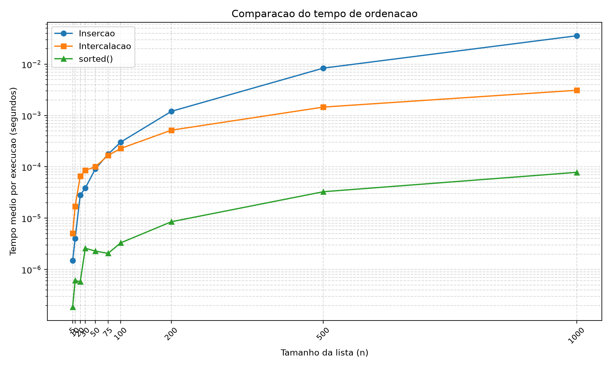
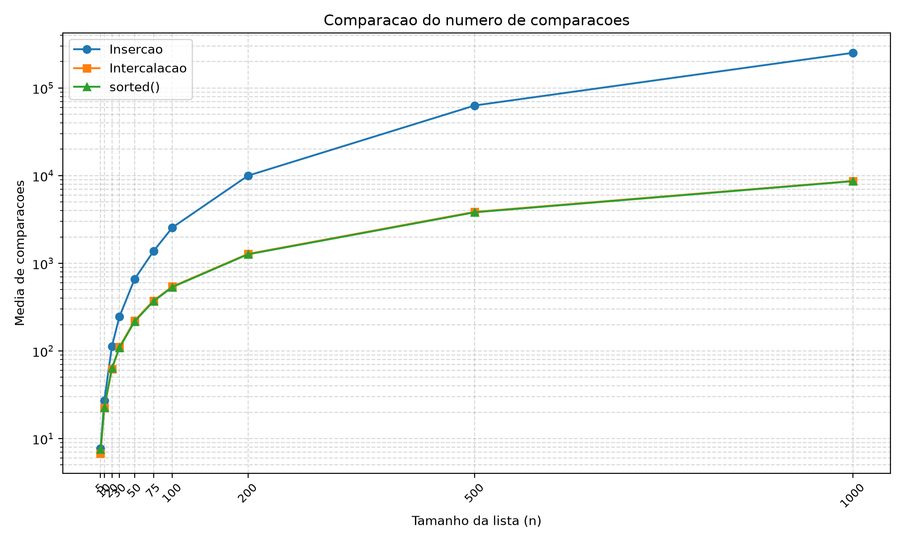

# Comparação entre os Algoritmos de Ordenação por Inserção e Intercalação

## 1. Objetivo

Este trabalho tem como objetivo comparar os algoritmos de ordenação por inserção (Insertion Sort) e por intercalação (Merge Sort). Para isso, foram observados o tempo de execução e o número de comparações realizadas com listas de diferentes tamanhos.

Também foi utilizado o método `sorted()` do Python para comparar os resultados com uma função de ordenação já disponível na linguagem.

## 2. Como os testes foram realizados

Os testes foram feitos com listas de 5, 10, 20, 30, 50, 75, 100, 200, 500 e 1000 números. Os valores das listas foram gerados aleatoriamente, entre 0 e 10000.

Para cada tamanho, foram realizadas 10 repetições. Em cada repetição, o tempo foi medido em um lote de 100 execuções, utilizando `time.perf_counter()`. Ao final, foi calculada a média do tempo por execução.

O número de comparações foi contado durante a execução dos algoritmos. Para o `sorted()`, foi criada uma classe que contabiliza as comparações feitas pelo método `__lt__`.

Os resultados foram salvos em `dados.csv`. O programa também gera dois gráficos: um para os tempos e outro para as comparações.

## 3. Resultados

### 3.1 Tempo médio de execução

A tabela apresenta os tempos médios registrados na última execução do programa. Os valores estão em segundos.

| Tamanho (n) | Inserção (s) | Intercalação (s) | `sorted()` (s) |
|---:|---:|---:|---:|
| 5 | 0,000001489700 | 0,000005077300 | 0,000000186900 |
| 10 | 0,000003989500 | 0,000016997200 | 0,000000612800 |
| 20 | 0,000028217900 | 0,000066172200 | 0,000000577200 |
| 30 | 0,000038536800 | 0,000085428400 | 0,000002596100 |
| 50 | 0,000091563800 | 0,000100574700 | 0,000002284000 |
| 75 | 0,000175689200 | 0,000166790100 | 0,000002063000 |
| 100 | 0,000303111800 | 0,000227979200 | 0,000003309000 |
| 200 | 0,001204884900 | 0,000517481400 | 0,000008520700 |
| 500 | 0,008362291400 | 0,001457207900 | 0,000032735700 |
| 1000 | 0,035667201500 | 0,003096322200 | 0,000078066900 |

### 3.2 Número médio de comparações

| Tamanho (n) | Inserção | Intercalação | `sorted()` |
|---:|---:|---:|---:|
| 5 | 7,7 | 6,8 | 7,5 |
| 10 | 27,2 | 22,4 | 22,8 |
| 20 | 112,8 | 61,9 | 63,4 |
| 30 | 246,1 | 111,0 | 108,7 |
| 50 | 658,8 | 221,7 | 216,4 |
| 75 | 1.373,7 | 374,6 | 368,6 |
| 100 | 2.559,7 | 542,8 | 535,6 |
| 200 | 9.986,6 | 1.279,7 | 1.264,8 |
| 500 | 63.177,7 | 3.861,3 | 3.815,5 |
| 1000 | 251.806,4 | 8.693,9 | 8.638,4 |

## 4. Análise dos resultados

### 4.1 Tempo de execução

Nos testes com listas de até 50 elementos, a inserção foi mais rápida que a intercalação. A partir de 75 elementos, a intercalação passou a apresentar menor tempo de execução.

A diferença fica mais evidente com 1000 elementos: a inserção levou aproximadamente 0,0357 segundo, enquanto a intercalação levou 0,0031 segundo.

O `sorted()` apresentou os menores tempos registrados em todos os tamanhos testados.

### 4.2 Número de comparações

A intercalação realizou menos comparações que a inserção em todos os tamanhos avaliados. Para 1000 elementos, foram aproximadamente 8.694 comparações na intercalação e 251.806 na inserção.

Isso ajuda a explicar a diferença de desempenho nas listas maiores. Mesmo assim, o número de comparações não determina sozinho o tempo total: a criação de listas e as chamadas recursivas também têm custo.

### 4.3 Comparação entre os pontos de virada

Os gráficos não apresentam o mesmo ponto de virada. No número de comparações, a intercalação já apresenta valores menores que a inserção desde o primeiro tamanho testado. No tempo de execução, porém, a inserção foi mais rápida até 50 elementos, enquanto a intercalação passou a ser mais rápida a partir de 75 elementos.

Essa diferença ocorre porque o tempo de execução não depende apenas da quantidade de comparações. A intercalação também precisa dividir as listas, realizar chamadas recursivas e juntar os resultados. Para listas pequenas, esses custos influenciam o desempenho.

## 5. Comparação com o sorted()

O `sorted()` foi o método mais rápido nos testes. Diferentemente dos dois algoritmos implementados no trabalho, ele utiliza o Timsort, que já é otimizado na implementação do Python.

Para 1000 elementos, o método realizou uma média de 8.638 comparações, valor próximo ao registrado pela intercalação. Entretanto, seu tempo de execução foi menor.

Essa comparação mostra a diferença entre implementar um algoritmo para fins de estudo e utilizar uma função de ordenação otimizada da linguagem.

## 6. Comparações do sorted() e referência n log n

Para 1000 elementos, o `sorted()` realizou uma média de 8.638,4 comparações. Usando como referência \(n\log_2 n\), temos:

\[
1000\log_2(1000)\approx 9965,8
\]

O número de comparações observado ficou abaixo desse valor de referência. Isso permite comparar o resultado experimental com a ordem de crescimento estudada em aula, mas não comprova sozinho a complexidade do algoritmo, pois foram utilizadas listas aleatórias e um conjunto limitado de tamanhos.

A contagem foi realizada por meio de uma classe que incrementa um contador sempre que o método `__lt__` é chamado durante a ordenação.

## 7. Conclusão

Com os resultados obtidos, foi possível observar que o algoritmo de inserção funciona bem para listas pequenas, mas perde desempenho conforme o tamanho aumenta. A intercalação apresentou menor tempo de execução a partir de 75 elementos e realizou menos comparações em todos os tamanhos testados.

O método `sorted()` apresentou o menor tempo de execução entre os três métodos avaliados. Os resultados também mostram que analisar somente o tempo de execução ou o número de comparações não é suficiente para explicar todo o desempenho de um algoritmo.

As conclusões se limitam às listas aleatórias e às condições utilizadas neste experimento. Em outras máquinas ou com listas de características diferentes, os resultados podem variar.

## 8. Arquivos do projeto

- `ordenacao.py`: contém os algoritmos de inserção e intercalação.
- `testes.py`: verifica o funcionamento dos algoritmos em diferentes casos.
- `medir.py`: executa as medições, calcula as médias e gera os arquivos de resultados.
- `dados.csv`: armazena os resultados das medições.
- `graficos/tempos.png`: apresenta a comparação dos tempos.
- `graficos/comparacoes.png`: apresenta a comparação do número de comparações.
- `README.md`: contém as instruções para executar o projeto.
- `RELATORIO.md`: apresenta os procedimentos, os resultados e a conclusão do experimento.
